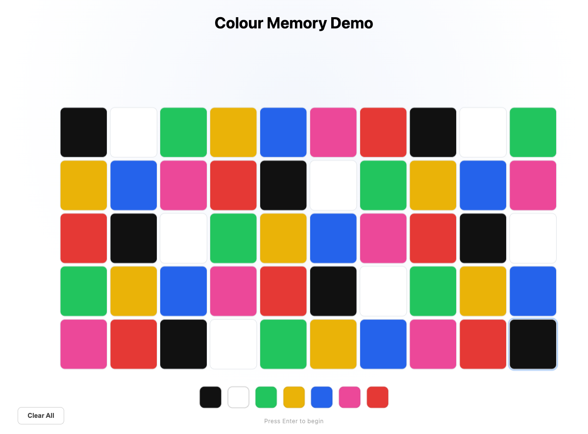
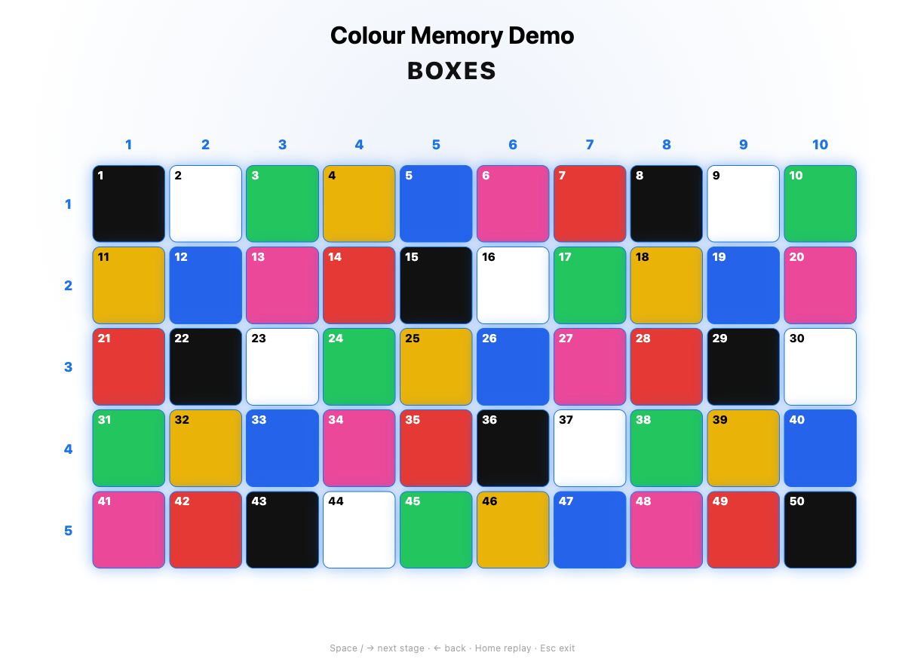
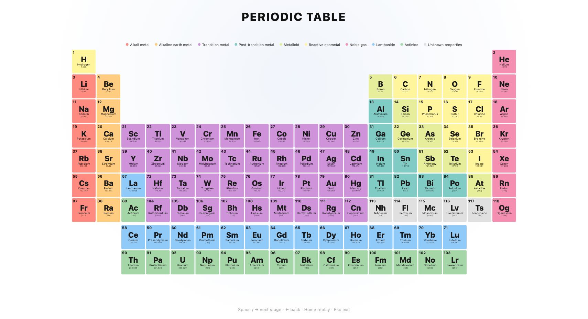
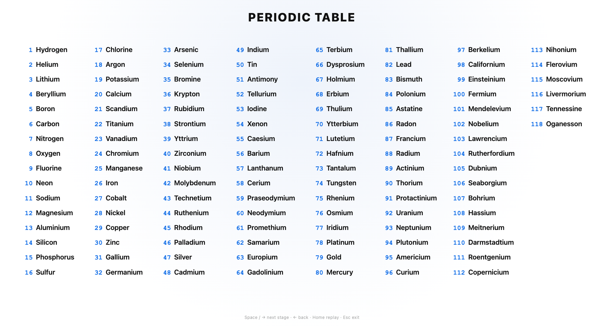
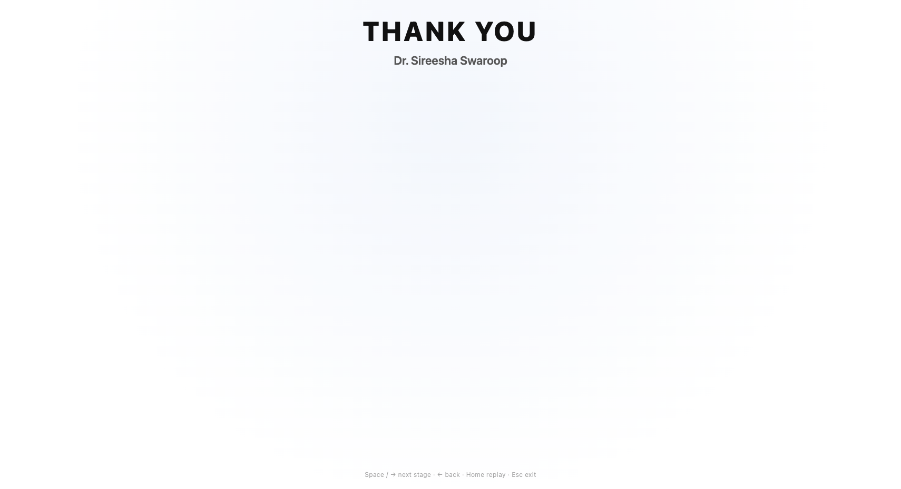

# 🧠 Memory Demo

A little full-screen app built for one very specific, very special use case: **my mom's live memory demonstrations.**

She trains under **Squadron Leader Jayasimha** — a 14x Guinness World Record holder, Chairman of the National Memory Council of India, and President of the World Memory Sports Council for India — and this app is her stage partner across three memory disciplines.

## ✨ What it does

**Numbers & Colours** — same grid, same reveal engine, just different content:
1. **Enter a PIN** to get in (keeps curious hands off before showtime).
2. **Pick an activity** — Numbers or Colours.
3. **Fill the grid** — type 50 two-digit numbers, or paint 50 boxes from a 7-colour palette.
4. **Lock it in** and step through the reveal: rows → columns → box numbers → a finale flourish → a thank-you screen.

**Periodic Table** — a third discipline, fixed and always correct (no typing needed). Click it and go straight into a two-act reveal: first the real periodic table — all 118 elements in their official group/period positions, colour-coded by category with a legend, matching the standard printed chart — then a switch to a simpler two-column (number, name) list for the actual memorization proof, followed by a finale and thank you.

## 📸 Screenshots

| | |
|---|---|
| **PIN gate** |  |
| **Choose an activity** |  |
| **Grid, locked in** |  |
| **Rows revealed** |  |
| **Columns revealed** |  |
| **Box numbers revealed** |  |
| **Thank you** |  |
| **Colours, filling in** |  |
| **Colours, box numbers** |  |
| **Periodic Table, official layout** |  |
| **Periodic Table, list format** |  |
| **Periodic Table, thank you** |  |

## 🚀 Running it

```bash
npm start
```

Zero dependencies — a tiny Node server (`server.js`) serves a small set of static files (`index.html`, `style.css`, `script.js`, `periodic.css`, `periodic.js`, `data/elements.js`). Open the printed URL, or just open `index.html` directly.

## 🎛 Controls (once the reveal starts)

| Key | Action |
|---|---|
| `Space` / `→` | Next stage |
| `←` | Previous stage |
| `Home` | Replay from the start |
| `Esc` | Exit full screen, back to the activity picker |

## 🔒 About the PIN

The PIN lives in a constant near the top of `script.js` — change it before the show. It's a light deterrent for a casual auditorium of curious students, not real security: it's client-side only, so anyone who opens the browser's dev tools can read it in the source. The thing that actually matters is physical control of the presenting device — don't leave it unattended.

## 📱 Works on

Desktop, projector screens, tablets, and phones — the grid adapts to whatever shape screen it's shown on.

---

Built for one performance, by her son. Break a leg, Mom. 💙
