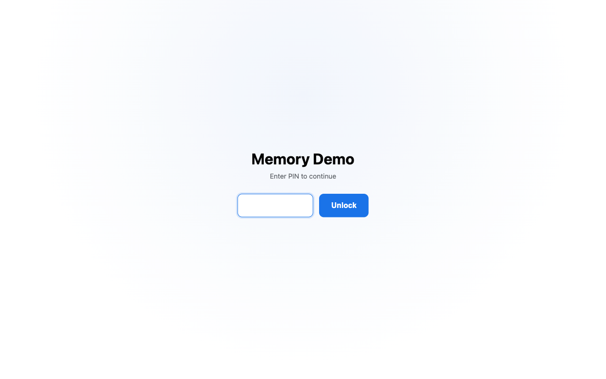
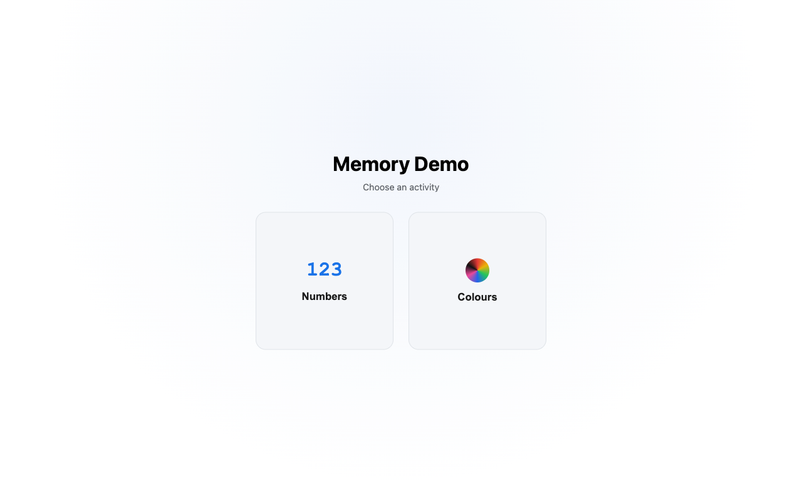
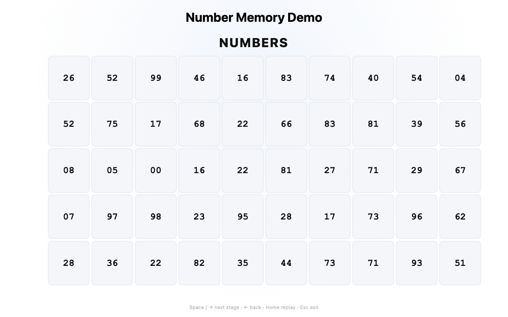
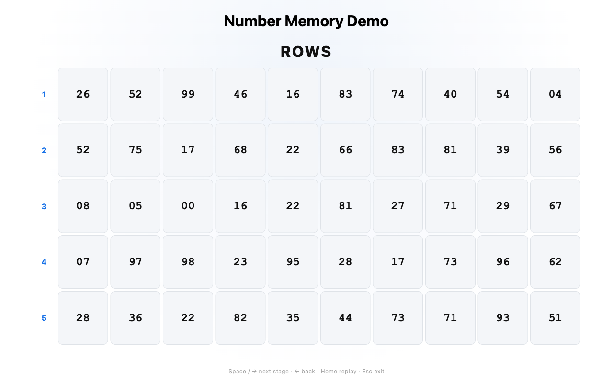
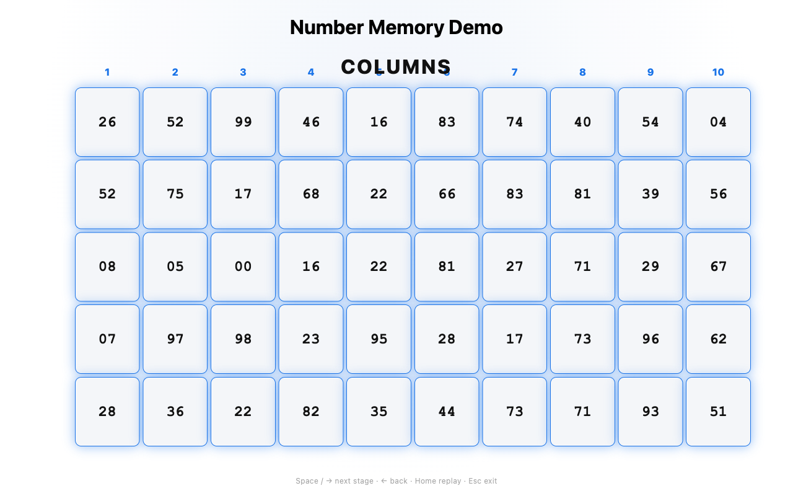
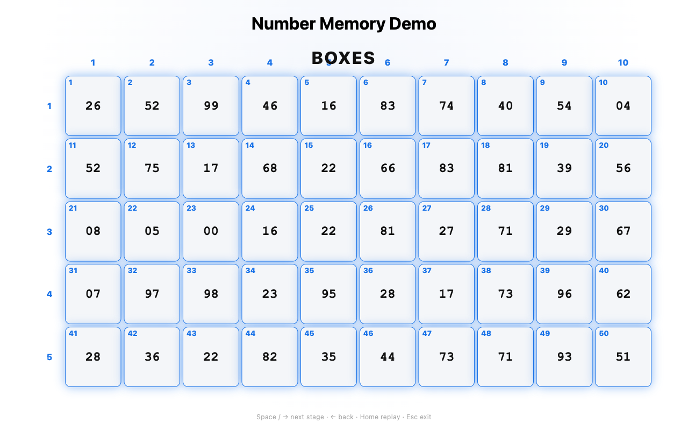
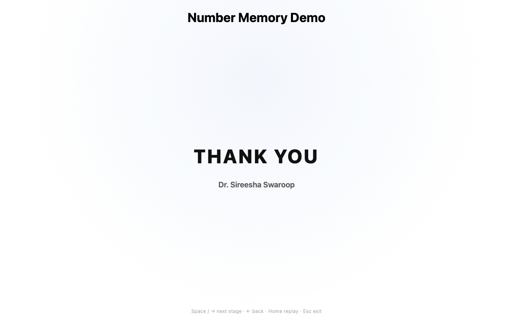

# 🧠 Memory Demo

A little full-screen app built for one very specific, very special use case: **my mom's live memory demonstrations.**

She trains under **Squadron Leader Jayasimha** — a 14x Guinness World Record holder, Chairman of the National Memory Council of India, and President of the World Memory Sports Council for India — and this app is her stage partner: she memorizes a 5×10 grid of 50 two-digit numbers (or 50 colours), recites it live, and this app proves it, revealing the grid row by row, then column by column, then box by box, with the audience watching the whole time.

## ✨ What it does

1. **Enter a PIN** to get in (keeps curious hands off before showtime).
2. **Pick an activity** — Numbers or Colours.
3. **Fill the grid** — type 50 two-digit numbers, or paint 50 boxes from a 7-colour palette.
4. **Lock it in** and step through the reveal: rows → columns → box numbers → a finale flourish → a thank-you screen.

Same grid, same animations, same reveal engine for both activities — just numbers or colours filling the boxes.

## 📸 Screenshots

| | |
|---|---|
| **PIN gate** |  |
| **Choose an activity** |  |
| **Grid, locked in** |  |
| **Rows revealed** |  |
| **Columns revealed** |  |
| **Box numbers revealed** |  |
| **Thank you** |  |

## 🚀 Running it

```bash
npm start
```

Zero dependencies — a tiny Node server (`server.js`) serves three static files (`index.html`, `style.css`, `script.js`). Open the printed URL, or just open `index.html` directly.

## 🎛 Controls (once the reveal starts)

| Key | Action |
|---|---|
| `Space` / `→` | Next stage |
| `←` | Previous stage |
| `Home` | Replay from the start |
| `Esc` | Exit full screen, back to the activity picker |

## 🔒 About the PIN

The PIN lives in a constant near the top of `script.js` — change it before the show. It's a light deterrent for a casual auditorium of curious students, not real security: it's client-side only, so anyone who opens the browser's dev tools can read it in the source. The thing that actually matters is physical control of the presenting device — don't leave it unattended.

## 📱 Works on

Desktop, projector screens, tablets, and phones — the grid adapts to whatever shape screen it's shown on.

---

Built for one performance, by her son. Break a leg, Mom. 💙
